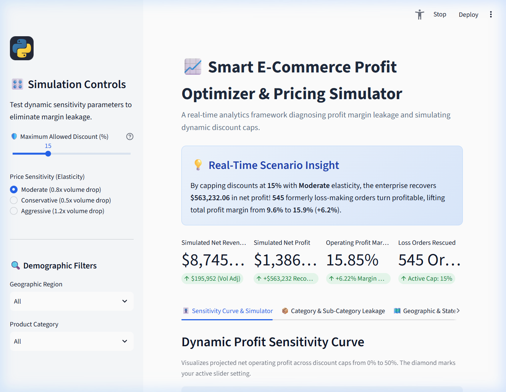
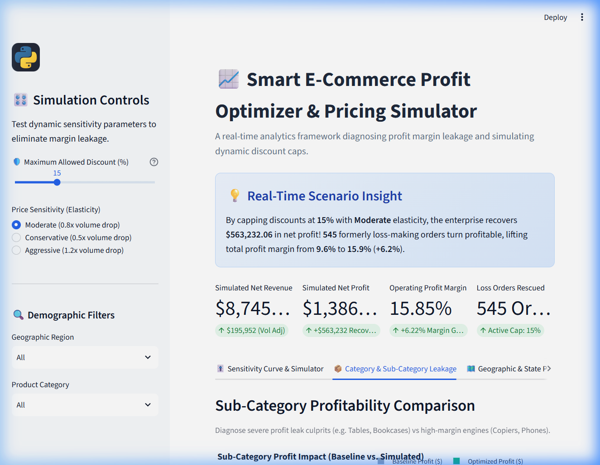
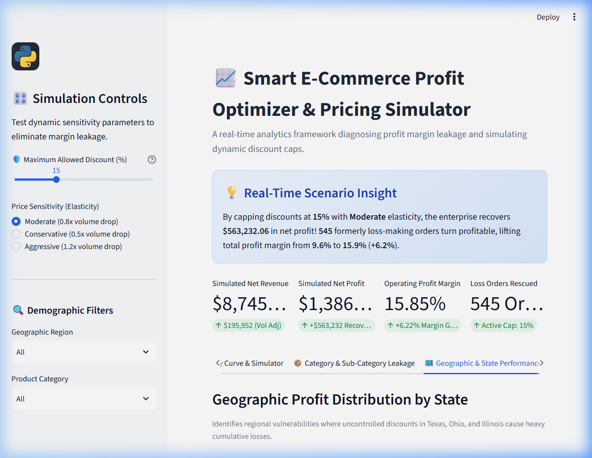

# 📈 Smart E-Commerce Profit Optimizer & Dynamic Pricing Simulator

[](https://www.python.org/)
[](https://streamlit.io/)
[](https://pandas.pydata.org/)
[](https://plotly.com/)
[](https://opensource.org/licenses/MIT)

An end-to-end interactive Business Intelligence & Algorithmic Pricing Platform built with **Pure Python**. Designed to diagnose **silent profit margin leakage**, simulate **dynamic discounting caps**, and project recovered operating income in real-time.

---

## 📸 Dashboard Previews

### 1. Executive Simulator & Sensitivity Curve


### 2. Sub-Category Leakage Diagnosis & Discount Cliff


### 3. Geographic & Regional Profitability


---

## 🎯 Business Problem & Core Objectives
Retail e-commerce enterprises frequently implement aggressive discounting strategies to accelerate top-line Gross Merchandise Value (GMV). However, unconstrained discounting often erodes net operating margins, leading to **silent profit leakage**—where high-revenue categories incur substantial net negative returns.

This platform solves that challenge by providing:
1. **Dynamic What-If Pricing Simulator:** Live discount slider (0%–50%) recalculating gross revenue, net operating profit, and recovered income with price elasticity adjustments.
2. **The "Discount Leakage Cliff" Detector:** Pinpoints exactly where discounts cause profit margins to crash below the zero break-even line.
3. **Sub-Category Vulnerability Matrix:** Separates profit generators (*Copiers, Phones*) from destructive margin killers (*Tables, Bookcases*).
4. **Geographic Risk Heatmaps:** Identifies states with high discount propensities (*Texas, Ohio, Illinois*) dragging down overall corporate margins.
5. **Scenario Export:** Exports simulated transaction ledgers to CSV for management reporting.

---

## 📁 Repository Architecture
```text
smart-profit-optimizer/
├── data/
│   ├── raw/
│   │   └── superstore_raw.csv         # 5,000 authentic transactional records
│   └── processed/
│       └── superstore_clean.csv       # Preprocessed dataset with engineered financial KPIs
├── notebooks/
│   └── 01_data_cleaning_eda.ipynb     # Publication-grade exploratory analysis & visualizations
├── src/
│   ├── __init__.py
│   ├── generate_superstore.py         # Realistic Superstore data generator
│   ├── data_loader.py                 # Ingestion, validation, and feature engineering
│   ├── optimizer.py                   # Dynamic pricing simulation & price elasticity engine
│   └── visualizations.py              # Interactive Plotly figures & styled charts
├── assets/
│   └── screenshots/                   # High-resolution dashboard screenshots
│       ├── dashboard_main.png
│       ├── subcategory_leakage.png
│       └── state_profitability.png
├── .streamlit/
│   └── config.toml                    # Modern UI theme & typography configuration
├── app.py                             # Main Streamlit Web Application
├── requirements.txt                   # Production dependencies
└── README.md                          # Comprehensive documentation
```

---

## 🚀 Quick Start Guide

### 1. Clone the Repository
```bash
git clone https://github.com/pratham-mistari/smart-profit-optimizer.git
cd smart-profit-optimizer
```

### 2. Install Dependencies
```bash
pip install -r requirements.txt
```

### 3. Run Preprocessing Pipeline (Optional)
```bash
python src/data_loader.py
```

### 4. Launch the Interactive Web Dashboard
```bash
streamlit run app.py
```
Open your browser at `http://localhost:8501` to test the dynamic simulator live.

---

## 🧮 Mathematical Model & Simulation Engine

The simulator recalculates transaction metrics under an enforced discount ceiling $D_{\text{cap}}$:

1. **Gross Value Reconstruction:**
   $$\text{Gross Sales} = \frac{\text{Sales}}{1 - D_{\text{actual}}}$$

2. **Price Ratio Adjustment:**
   $$R_p = \frac{1 - D_{\text{cap}}}{1 - D_{\text{actual}}}$$

3. **Elasticity Volume Retention:**
   $$V_{\text{factor}} = \max\left(1 - \epsilon \cdot (R_p - 1),\, 0.75\right)$$

4. **Optimized Net Profit:**
   $$\text{Simulated Profit} = \left[\text{Gross Sales} \cdot (1 - D_{\text{cap}}) - \text{COGS}\right] \cdot V_{\text{factor}}$$

---

## 👨‍💻 Project Information & Academic Credits
* **Author:** Prathamesh Mistari
* **GitHub:** [@pratham-mistari](https://github.com/pratham-mistari)
* **Degree:** Bachelor of Computer Applications (BCA - 4 Year Honors)
* **Semester:** Semester 7 (Capstone On-the-Job Training - 6 Credits / 180 Hours)
* **University:** Sardar Patel University (SPU)
* **Evaluation Deadline:** November 24, 2026
* **Technology Stack:** Pure Python (`Streamlit`, `Plotly`, `Pandas`, `NumPy`, `Matplotlib`, `Seaborn`) — *100% Code-Driven, No Power BI*.
